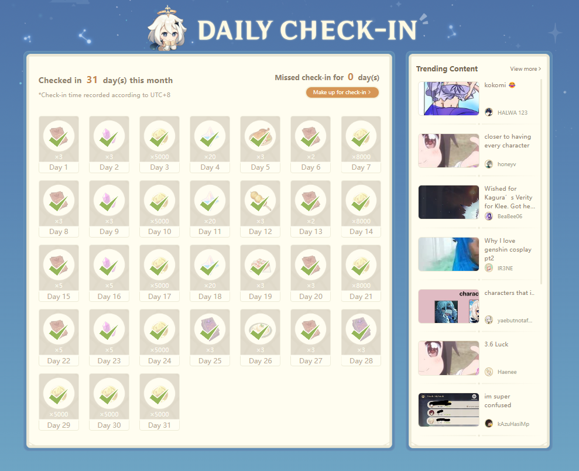
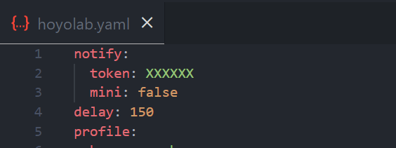

<div align="center">
  <h1>Hoyolab a Daily Check-in for Hoyoverse Game</h1>
  <p>
    <a href="https://github.com/dvgamerr-app/go-hoyolab/actions/workflows/build.yml">
      
    </a>
    
    <a href="https://goreportcard.com/report/dvgamerr-app/go-hoyolab">
      
    </a>
    <br>
    
    <a href="LICENSE">
      
    </a>
    <a href="https://github.com/dvgamerr-app/go-hoyolab/releases/latest">
      
    </a>
  </p>
  <p><a href="./README.md">English</a> | <a href="./README_TH.md">ภาษาไทย</a></p>
  <p>Genshin Impact, Honkai StarRail, Honkai Impact 3, Zenless Zone Zero. You only need to run it once, then it will continue to run forever.</p>
</div>





## Features
- [x] update new version from github automatic.
- [x] Claims checkin daily using the login saved in Firefox (or a Firefox fork: LibreWolf, Waterfox, Zen, Floorp).
- [x] Multiple browser profiles for multiple game accounts.
- Chrome, Edge and Brave are **no longer supported**: their cookies use App-Bound Encryption (`v20`) and cannot be read.
- [X] command line `hoyolab` support all os.
- [x] Line Notify support after checkin.

  

  

- [x] Discord Notify support after checkin.


  
  
- [x] Genshin Impact claims support.
- [x] Zenless Zone Zero claims support (`games: [GSI, HSR, ZZZ, HI3]` in hoyolab.yaml).
- [x] Honkai StarRail claims support.
- [x] Honkai Impact 3 claims support.

### Todo
- [ ] Zenless Zone Zero claims support.
- [ ] docker container support.
- [ ] support session with all browser.
- [ ] install schedule task with windows-os automatic.

---

## How to use
1. Open Firefox (not Chrome/Edge/Brave) and go to [https://www.hoyolab.com/home](https://www.hoyolab.com/home)
2. Login user genshin account for daily cliams.
3. run `hoyolab.exe`.
4. If found Error please craete issues in [https://github.com/dvgamerr-app/go-hoyolab/issues](https://github.com/dvgamerr-app/go-hoyolab/issues)
5. If Notify message after CheckIn use [LINE-Notify](https://notify-bot.line.me/my/)
6. log in that and `Generate token` in below page after that copy token paste in `hoyolab.yaml` in `notify.token` at `XXXXXX` same image:
 
 
  
7. If you don't play some game add `#` in first char in line scope, e.g. i don;t play honkai impact 

  


### Windows
### Solution If Turn On computer 24*7
- use `Task Scheduler` and `Create Basic Task`
- select `Daily` next time at `5 am`.
- after click Next select `Start a program`, Next and browse `hoyolab.exe`

### Solution If starup computer 
- create shortcut from `hoyolab.exe`
- copy shortcut to `C:\ProgramData\Microsoft\Windows\Start Menu\Programs\Startup`

### MaOcOS & Linux
- use `crontab` for automatic run.

## Prerequisites
- Have login to mihoyo's website at Firefox or a Firefox fork (A login for a year is enough).
- If your existing `hoyolab.yaml` has `profile[].browser: chrome` (or `edge`/`brave`), change it to `firefox`; such entries are ignored with a warning.
- Development builds need the sibling `go-kooky` checkout linked through a local, git-ignored `go.work` until a go-kooky release containing `CookiesForHost` is required from `go.mod`.

## Development

```shell
go test ./...
go vet ./...
go build ./...
```

Notification delivery is centralized in `act/notify.go`. LINE Notify and Discord preserve their existing payloads and status handling while sharing one Resty client per notification batch.

The notification regression tests use local HTTP test servers and do not send messages to external services.

## If you need help You can join Discord.

[](https://discord.gg/QDccF497Mw)
