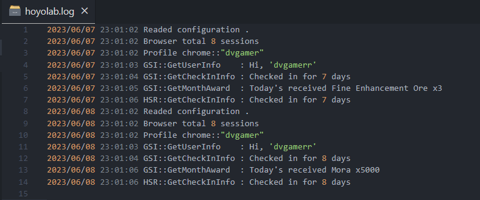
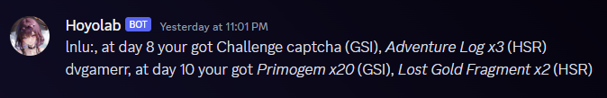

<div align="center">

# 🎮 go-hoyolab

**เช็คอิน HoYoLAB รายวันให้ทุกเกม HoYoverse — ตั้งครั้งเดียว จบ**

[](https://github.com/dvgamerr-app/go-hoyolab/actions/workflows/build.yml)
[](https://goreportcard.com/report/dvgamerr-app/go-hoyolab)
[](https://github.com/dvgamerr-app/go-hoyolab/releases/latest)
[](LICENSE)
[](https://github.com/dvgamerr-app/go-hoyolab/pulls)

[English](./README.md) · [ภาษาไทย](./README_TH.md) · [เว็บไซต์](https://dvgamerr-app.github.io/go-hoyolab/) · [Discord](https://discord.gg/QDccF497Mw)



</div>

## ✨ ทำไมต้องใช้

- **ไม่ต้องตั้งค่า login** — ใช้ session HoYoLAB ที่ล็อกอินค้างไว้ใน Firefox ได้เลย ไม่ต้องกรอกรหัสผ่านหรือ copy token
- **ไฟล์เดียวจบ** — `hoyolab` ตัวเดียว รันได้ทั้ง Windows, macOS, Linux และ FreeBSD ไม่ต้องติดตั้ง runtime หรือ Docker
- **ทุกเกมในครั้งเดียว** — เช็คอินทุกเกมที่เปิดไว้ รองรับหลายบัญชีผ่านหลาย profile
- **บอกว่าได้อะไรบ้าง** — แจ้งรางวัลของแต่ละเกมผ่าน Discord (หรือ LINE)
- **อัปเดตตัวเอง** — ตรวจและอัปเดตเวอร์ชันใหม่จาก GitHub อัตโนมัติ

## 🕹️ เกมที่รองรับ

| เกม | คีย์ใน `hoyolab.yaml` | เปิดเป็นค่าเริ่มต้น |
| --- | --- | :---: |
| Genshin Impact | `GSI` | ✅ |
| Honkai: Star Rail | `HSR` | ✅ |
| Zenless Zone Zero | `ZZZ` | ✅ |
| Honkai Impact 3rd | `HI3` | — |

## 🚀 เริ่มใช้งาน

1. เปิด **Firefox** (หรือ LibreWolf, Waterfox, Zen, Floorp) แล้วล็อกอินที่ <https://www.hoyolab.com/home>
2. ดาวน์โหลดไฟล์ของระบบปฏิบัติการคุณจาก [release ล่าสุด](https://github.com/dvgamerr-app/go-hoyolab/releases/latest) แล้วแตกไฟล์
3. รันโปรแกรม:

   ```shell
   ./hoyolab          # Windows: hoyolab.exe
   ```

เสร็จแล้ว ครั้งแรกโปรแกรมจะสร้าง `hoyolab.yaml` ไว้ข้างๆ ไฟล์โปรแกรม แก้ไฟล์นี้เพื่อเปิดแจ้งเตือนหรือเปิด/ปิดเกมได้

> [!IMPORTANT]
> **ไม่รองรับ Chrome, Edge และ Brave อีกต่อไป** เพราะเข้ารหัส cookie แบบ App-Bound Encryption (`v20`) ซึ่งอ่านจากภายนอกเบราว์เซอร์ไม่ได้ ถ้า `hoyolab.yaml` เดิมมี `profile[].browser: chrome` (หรือ `edge` / `brave`) ให้เปลี่ยนเป็น `firefox` — ถ้าไม่เปลี่ยนจะถูกข้ามพร้อมคำเตือน

ดูว่าเจอ profile ของเบราว์เซอร์อะไรบ้าง:

```shell
./hoyolab --list
```

## ⚙️ การตั้งค่า

```yaml
notify:
  discord-webhook: "https://discord.com/api/webhooks/..."   # ไม่บังคับ
  line-notify: ""                                           # ไม่บังคับ
  mini: true
profile:
  - browser: firefox
    name: []            # ว่าง = ทุก profile ของ Firefox หรือระบุชื่อ profile
games:                  # ลบหรือ comment เกมที่ไม่ได้เล่นออก
  - GSI
  - HSR
  - ZZZ
```

ไฟล์ตั้งค่าเก่าที่ยังใช้บล็อก `config:` รายเกมยังใช้ได้ และจะถูกแปลงให้อัตโนมัติเมื่อโปรแกรมเขียนไฟล์ครั้งถัดไป

## 🔔 การแจ้งเตือน

| ช่องทาง | วิธีตั้ง |
| --- | --- |
| **Discord** | สร้าง webhook ที่ *Channel settings → Integrations* แล้ววาง URL ที่ `notify.discord-webhook` |
| **LINE Notify** | สร้าง token ที่ [notify-bot.line.me](https://notify-bot.line.me/my/) แล้ววางที่ `notify.line-notify` (LINE ปิดบริการนี้แล้ว แนะนำให้ใช้ Discord) |



## ⏰ ตั้งให้รันทุกวัน

**Windows** — *Task Scheduler → Create Basic Task → Daily (เช่น 5 am) → Start a program → `hoyolab.exe`*
หรือจะวาง shortcut ของ `hoyolab.exe` ไว้ที่ `shell:startup` ให้เช็คอินทุกครั้งที่เปิดเครื่องก็ได้

**macOS / Linux** — ใช้ cron:

```cron
0 5 * * * /path/to/hoyolab
```

## 🛠️ สำหรับนักพัฒนา

```shell
go test ./...
go vet ./...
go build ./...
```

- test ไม่แตะ browser profile จริง, credential จริง หรือส่งแจ้งเตือนออกภายนอก
- ถ้า `go build` ติดเรื่อง VCS stamping ให้ใช้ `go build -buildvcs=false ./...`

## 💬 ขอความช่วยเหลือ

พบบั๊กหรืออยากให้เพิ่มเกม [เปิด issue](https://github.com/dvgamerr-app/go-hoyolab/issues) หรือเข้ามาคุยใน Discord ได้เลย (อธิบายปัญหาให้ละเอียดหน่อย แล้วจะมาตอบนะ)

[](https://discord.gg/QDccF497Mw)

## 📄 License

[MIT](./LICENSE) © Kananek Thongkam
